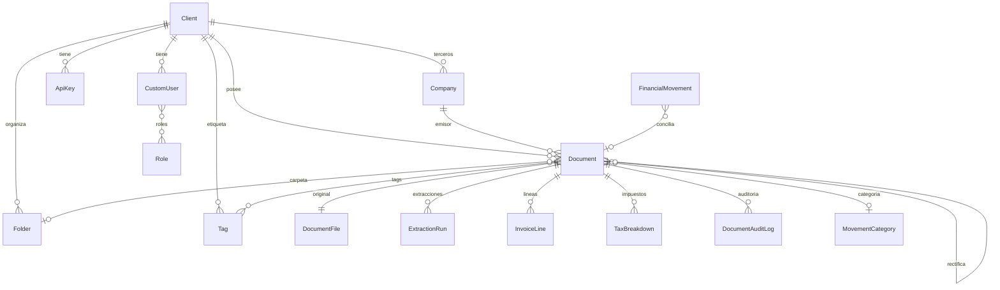

# Plan de migración a OCR con la API de Claude

Estado: **borrador pendiente de aprobación**. No se ha modificado código de producción, migraciones ni datos.
Las referencias `archivo:línea` marcadas con ✔ se comprobaron directamente; las marcadas con ~ provienen de la exploración y deben revalidarse antes de implementar.

---

## 1. Resumen ejecutivo

1. Hoy la app **no hace OCR**: recibe de n8n el archivo y los datos ya extraídos en `POST /api/v1/documents/ingest/`. No hay rastro de n8n en el repo; su contrato está implícito en `api/serializers.py`.
2. El núcleo (multi-tenant por `Client`, ciclo pending/approved/rejected/archived, rectificaciones versionadas, export CSV/Excel/PDF, métricas) es **reutilizable**; la suite actual pasa: **200 passed** (50 s).
3. El esquema **no soporta** el nuevo flujo: no hay hash/MIME/tamaño del archivo, ni registro de extracciones (modelo, tokens, coste), ni líneas, ni IVA por tipo, ni retenciones, IBAN o moneda.
4. No existe cola asíncrona, ni SDK `anthropic`, ni `pydantic`, ni `factory_boy`, ni UI de subida.
5. **Riesgo previo al OCR (bloqueante):** `/media/` se sirve sin autenticación ni tenant, la API key se imprime en logs y hay una fuga entre tenants en el formulario de rectificación.
6. Recomendación: hito 0 de hardening, luego modelos aditivos, servicio de extracción detrás de una interfaz (Haiku 5.5 → fallback Sonnet 5.5), cola con Celery + Redis, almacenamiento en S3, validación determinista y revisión humana; n8n convive hasta alcanzar el criterio de apagado.
7. Once hitos pequeños y desplegables, en su mayoría S/M; los grandes son extracción (L) y UI (L).

---

## 2. Hallazgos de la auditoría de lógica de negocio

### 2.1 Flujo actual de entrada
- Ruta `api/urls.py` → `DocumentIngestAPIView` (`api/views.py` ~108), `authentication_classes = []`, permiso `HasApiKey` (cabecera `X-API-Key: <prefix>.<secret>`, hash con `make_password`) ~.
- Payload multipart (`api/serializers.py` ~5-52): `file`, `external_id`, `original_name`, `document_type` (invoice/delivery/corrected_invoice), `provider_name`, `provider_tax_id`, `document_number`, `issue_date`, `base_amount`, `tax_amount`, `total_amount`, `tax_percentage`, `flow`, `confidence{confianza_extraccion, fecha, total}`.
- Decisión de revisión (`get_review_level`/`get_status`, `api/views.py` ~13-33): confianza ≥0.9 → `auto` (se guarda `approved`); <0.75, fecha<0.7 o total<0.8 → `required`; resto `recommended`.
- `normalize_tax` (`documents/utils.py`) rellena el importe que falte; no hay retenciones/IRPF en todo el código.
- Empresa: `get_or_create_company` (`api/views.py:49`) busca por NIF, luego por nombre `iexact`, con `select_for_update` y captura de `IntegrityError`.
- Idempotencia: solo `UniqueConstraint(client, external_id)` (`documents/models.py:294` ✔). **No hay hash de archivo ni control `company+document_number`.**
- Multi-tenant: todas las vistas web filtran por `request.user.client`. `Role` existe pero ninguna vista lo consulta: cualquier usuario del cliente aprueba/rechaza/archiva/rectifica.

### 2.2 Contrato n8n (reconstruido) y responsabilidades a absorber
Búsqueda de `n8n|webhook|drive` en `*.py/*.yml/*.md`: sin coincidencias salvo el propio plan (`.claude/plans/plan-migracion-ocr.md:2,18`). A absorber: recepción de archivo, OCR, clasificación de tipo y de flujo (`in`/`out`), confianza por campo, deduplicación y archivo organizado (hoy Drive/Docs).

### 2.3 Problemas detectados

| # | Gravedad | Hallazgo | Evidencia |
|---|---|---|---|
| 1 | Crítica | `/media/` servido con `serve` sin auth ni comprobación de tenant, también con `DEBUG=False` | `billing_ai/urls.py:29` ✔ (+ `middleware.py` solo evita directorios ~) |
| 2 | Crítica | Se imprimen cabeceras y la API key en logs | `api/views.py:113-114` ✔ |
| 3 | Alta | Fuga entre tenants: `Company.objects.all()` en el form de rectificación, sin `get_form_kwargs` en la vista | `documents/forms/document_rectification_form.py:20` ✔; `documents/views.py:420` ✔ |
| 4 | Alta | Errata `company.is_supplier = True` (campo inexistente; el `save(update_fields=["is_provider",…])` no persiste el cambio) | `api/views.py:77,85` ✔ |
| 5 | Alta | Rutas `approve/reject` apuntan a funciones auxiliares `(request, document)`; con `pk=` dan `TypeError` (la UI usa `POST action=`) | `documents/urls.py:14-15` ✔, `documents/views.py:123,128` ✔ |
| 6 | Alta | Auto-aprobación salta `can_be_approved` y no valida `base+IVA=total`; importes ausentes se guardan como 0 | `api/views.py` ~128,172-175 ~ |
| 7 | Alta | `ALLOWED_HOSTS=["*"]` en producción, sin `SECURE_*`; `DEBUG=True` fijo en base | `settings/production.py:7` ✔, `settings/base.py:12,14` ✔ |
| 8 | Media | `TokenAuthentication` por defecto sin `rest_framework.authtoken` instalado | `settings/base.py:125` ✔ |
| 9 | Media | Dinero como `FloatField` en el serializer → `Decimal(str(float))` | `api/serializers.py` ~ |
| 10 | Media | Rectificación: campos vacíos del form pisan el valor original (clave presente con `None`) | `documents/models.py:380-420` ✔ (a confirmar en test) |
| 11 | Media | Exportes: `float(Sum(...))` falla con queryset vacío (`None`) | `documents/utils.py:37-39,81-83` ✔; empresa/fecha nulas en bucle ~ |
| 12 | Media | Rectificativas: signo distinto entre export y `MetricsService.signed()` | `documents/utils.py` vs `services/metrics_service.py` ~ |
| 13 | Media | Ingesta no atómica: empresa huérfana y archivo subido si falla el `create`; `IntegrityError` de `external_id` en carrera → 500 | `api/views.py:112-187` ~ |
| 14 | Media | `Document.save()` ejecuta `full_clean()` siempre (coste en cargas masivas, rechaza `update_fields`) | `documents/models.py:310` ✔ |
| 15 | Media | Sin `LOGGING`, sin límites de subida, sin validación MIME/tamaño | `settings/*` ~ |
| 16 | Baja | Código muerto: `render_pdf_preview` importado y sin uso, `orc_snapshot` (errata, sin uso), `ApiKey.has_scope`, `DocumentService.auto_approve` | `documents/urls.py:7` ✔, `documents/models.py:277` ✔ |
| 17 | Baja | Duplicación: `get_exportable_queryset` x2 (`views.py:218,264`) ✔, CSV/Excel, parseo decimal (`CommaDecimalField` vs `parse_decimal`), JS pdf.js en `document_detail.html` y `document_rectify.html` | ver rutas |
| 18 | Baja | N+1: export sin `select_related("company")`; listado sin `select_related` ~ | `documents/utils.py`, `views.py` ~ |
| 19 | Baja | Índices: faltan `Document(client,is_current)`, `(client,issue_date)`; `ApiKey.prefix` con 3 índices solapados | `documents/models.py` Meta, `api/models.py` ~ |
| 20 | Baja | Dockerfile instala `weasyprint==59.0` y `requirements.txt` fija 60.2; `CLAUDE.md` dice Django 6.0.3/DRF 3.16.1 y real es 6.1.3/3.18.3 | `Dockerfile:31` ✔, `requirements.txt:6,8,30` ✔ |

Lógica en vistas a mover a servicios: política de ingesta (`api/views.py` → `DocumentIngestService`), agregados de `DashboardView` (`documents/views.py` ~157-213), máquina de estados en `DocumentDetailView.post()`.

> Descartado tras verificación: el hallazgo preliminar «`api.MetricsDashboardView` no devuelve nada» era falso (devuelve `Response(metrics)`); sí le falta tratar `parse_date(None)`, que lanza `TypeError` si falta el parámetro.

### 2.4 Infraestructura
Sin cola ni worker (gunicorn 2 workers, `--timeout 60`: una llamada OCR síncrona es inviable); sin `anthropic`, `pydantic`, `factory_boy`, `pillow-heif`, librerías PDF/poppler; sin storage por tenant (`upload_to="documents/"`, `documents/models.py:203` ~); variables de entorno actuales: `SECRET_KEY`, `POSTGRES_*`, `DJANGO_SETTINGS_MODULE`. **Faltarán:** `ANTHROPIC_API_KEY`, `EXTRACTION_MODEL`, `EXTRACTION_FALLBACK_MODEL`, `EXTRACTION_MAX_FILE_MB`, `EXTRACTION_MAX_PAGES`, `CELERY_BROKER_URL`, `R2_ACCOUNT_ID`, `R2_ACCESS_KEY_ID`, `R2_SECRET_ACCESS_KEY`, `R2_BUCKET_NAME`, `R2_ENDPOINT_URL`, `DOCUMENT_RETENTION_YEARS`.

---

## 3. Modelos: veredicto y diseño propuesto

### 3.1 Tabla de veredictos

| Modelo | Relaciones / constraints / índices relevantes | Veredicto | Justificación |
|---|---|---|---|
| `clients.Client` | sin constraints; `is_active` nunca se comprueba | MODIFICAR | Añadir `unique(tax_id)` condicional opcional y aplicar `is_active` en login/API key |
| `clients.Role` | `unique(client, code)` | USABLE | Falta usarlo para autorizar (revisar/aprobar/exportar) |
| `clients.CustomUser` | FK Client CASCADE, M2M Role, `m2m_changed` (sin dirección inversa) | USABLE | Cubrir `reverse=True` en la señal |
| `api.ApiKey` | `unique(prefix)`, `Index(prefix,is_active)`, `db_index` redundante | MODIFICAR | Quitar índice duplicado; usar `scopes` (`documents:ingest`) y `environment`; throttling |
| `documents.Company` | FK Client; `unique(client,tax_id)` condicional; índices `(client,tax_id)`,`(client,name)` | MODIFICAR | Pasa a «tercero»: `tax_id` vacío→NULL, `address`, `country`, `iban` opcional; dedupe por NIF normalizado y validado |
| `documents.Document` | FK Client CASCADE, Company SET_NULL, 5 FKs usuario PROTECT, `parent_document` PROTECT; `unique(client,external_id)`; `unique(parent_document) WHERE is_current` | MODIFICAR | Conservar ciclo de vida y versionado. Añadir: `currency`, `iban`, `period_quarter`, `category` FK a `DocumentCategory`, `processing_status`, `source`, `net/retención`. `Decimal` en vez de float. `orc_snapshot` → migrar a `ExtractionRun.raw_response` |
| `finance.MovementCategory` | `unique(client,name,type)` | USABLE | Se mantiene solo para movimientos; los documentos usan el nuevo `DocumentCategory` |
| `finance.FinancialMovement` | FK Client, category PROTECT; tipos investment/loan fuera de `choices` | MODIFICAR | Opcional `document` FK para conciliar; corregir choices |
| (nuevo) `DocumentFile` | OneToOne/FK a Document; `sha256`, `mime`, `size`, `origin`, `uploaded_by`, `page_count`; `unique(client, sha256)` | CREAR | Duplicados por hash y trazabilidad del original |
| (nuevo) `ExtractionRun` | FK Document; `status`, `model`, `prompt_version`, `raw_response` JSON, `confidence`, `error`, `input_tokens`, `output_tokens`, `cache_read_tokens`, `cost_usd`, `attempt`, `started_at/finished_at`; índice `(document, -started_at)` | CREAR | Observabilidad, coste y reintentos |
| (nuevo) `InvoiceLine` | FK Document CASCADE; `description`, `quantity`, `unit_price`, `tax_rate`, `amount` | CREAR | Líneas de factura |
| (nuevo) `TaxBreakdown` | FK Document CASCADE; `kind` (IVA/IRPF/RE), `rate`, `base`, `amount`; `unique(document,kind,rate)` | CREAR | IVA por tipo y retenciones |
| (nuevo) `Folder` / `Tag` | FK Client; M2M con Document; `unique(client, name)` | CREAR | Archivo y organización |
| (nuevo) `DocumentAuditLog` | FK Document, FK user SET_NULL; `action`, `changes` JSON, `created_at` | CREAR | Quién cambió qué (sustituye a los 5 FKs `*_by` solo como histórico; no se eliminan) |

Veredicto REEMPLAZAR/ELIMINAR: ninguno de los modelos actuales; los campos sin uso (`flow_source`, `total_source`, `review_started_at`) se mantienen hasta decidir en H1.

### 3.2 Diagrama de relaciones propuesto

### 3.3 Estrategia de migración de datos
- Todo **aditivo** (tablas y columnas nuevas nullable); ningún `DROP` ni renombrado en el primer despliegue.
- Backfill con comandos de gestión idempotentes y por lotes: `DocumentFile` (calcular SHA-256 de los PDF/imágenes existentes en disco; los que falten se marcan `missing`), `TaxBreakdown` (una fila IVA con `tax_percentage/base/tax_amount`), `DocumentAuditLog` inicial desde `*_by`/`*_at`.
- Riesgos: archivos ausentes en `media/` (bajo), colisión de `unique(client, sha256)` si hay duplicados reales (medio: informar en vez de fallar), tiempo de backfill en PostgreSQL (bajo). Hacer backup previo y ensayar en copia.
- Renombrar `orc_snapshot` → copiar a `ExtractionRun` en un hito posterior, borrar columna solo cuando se apague n8n.

---

## 4. Plan por hitos

| Hito | Contenido | Archivos afectados (principales) | Dep. | Tamaño | Riesgo |
|---|---|---|---|---|---|
| H0 Hardening (**primero: seguridad y multi-tenant**) | Acceso a archivos con comprobación de tenant (URLs firmadas de S3 de corta duración, generadas en una vista autenticada); quitar `print`; corregir `is_supplier`, rutas approve/reject, scoping de `company` en rectificación, `parse_date(None)`; `LOGGING`; `SECURE_*`/`ALLOWED_HOSTS` por env; `authtoken` o quitar `TokenAuthentication`; índices (la rotación de API keys se hará más adelante, ver §6) | `billing_ai/urls.py`, `billing_ai/middleware.py`, `settings/base.py` (`STORAGES` con `django-storages`/`boto3`), `api/views.py`, `documents/urls.py`, `documents/views.py`, `documents/forms/document_rectification_form.py`, `settings/*` | — | M | Migrar los archivos existentes de `media/` a S3 |
| H1 Modelos | Nuevos modelos (§3), migraciones aditivas, backfill, `factory_boy` factories | `documents/models.py` (o paquete `documents/models/`), `documents/migrations/`, `documents/tests/factories.py` | H0 | M | Backfill |
| H2 Extracción | `documents/services/extraction/{base.py,claude.py,schemas.py,prompts.py,pricing.py}`: interfaz `Extractor`, `ClaudeExtractor`, esquema Pydantic + tool use, clasificación (factura/ticket/presupuesto/albarán) en la misma llamada, prompt caching de instrucciones+esquema, modelos por settings (`claude-haiku-5-5`, fallback `claude-sonnet-5-5`), registro de tokens/coste en `ExtractionRun` | `requirements.txt` (`anthropic`, `pydantic`), `settings/base.py` | H1 | L | Calidad en facturas manuscritas/tickets |
| H3 Preprocesado | HEIC→JPG (`pillow-heif`), rotación EXIF, límites tamaño/páginas, PDF multipágina (rasterizar o enviar PDF nativo), `libheif`/`poppler` en Dockerfile | `documents/services/preprocess.py`, `Dockerfile` | H2 | M | Dependencias de sistema |
| H4 Cola | **Celery + Redis** (decidido): `billing_ai/celery.py`, tarea `process_document(document_id)` idempotente por hash/estado, `autoretry_for` con backoff y jitter, `soft_time_limit`, manejo de 429, servicios `redis` y `worker` en compose | `billing_ai/celery.py`, `documents/tasks.py`, `docker-compose*.yml`, `entrypoint.sh`, `settings/base.py`, `requirements.txt` | H2 | M | Nueva infraestructura (Redis) a operar |
| H5 Validación | `documents/services/validation.py`: NIF/CIF/NIE, cuadre base+IVA−retención=total (tolerancia 0,01), fechas plausibles, duplicados por hash y NIF+número; política: ok→`auto` solo si todo válido y confianza ≥ umbral; si falla → reintento con Sonnet; si sigue → revisión humana | `documents/services/validation.py`, `documents/validators.py` | H2 | M | Umbrales a calibrar con el dataset |
| H6 UI | Subida (multi-archivo, `capture` móvil), pantalla de revisión lado a lado con campos editables, listado/archivo con filtros por carpeta/etiqueta/trimestre; extraer JS común de detalle/rectify | `documents/views.py` (CBV finas), `documents/forms/`, `templates/private/documents/`, `static/js/` | H4, H5 | L | Reutilizar `DocumentSelector` |
| H7 Métricas/export | Agregados por periodo/proveedor/categoría, signos de rectificativas unificados, export vacío/nulos, sanear fórmulas CSV/Excel, `select_related` | `documents/services/metrics_service.py`, `documents/utils.py` | H1 | M | Cambio de cifras visibles |
| H8 Observabilidad y RGPD | Logger por documento (ids, no NIF/nombres), métrica de coste/tokens, retención configurable, claves S3 por tenant (`client_id/<tipo>/AAAA/MM/<sha256><ext>` (ya implementado en H0)), bucket privado, cifrado SSE | `settings/base.py`, `documents/services/`, comando `purge_expired` | H2 | M | Retención legal (6 años facturas) |
| H9 Batch | Cliente Batch API para cargas masivas (importación histórica), comando `submit_batch`/`collect_batch` | `documents/services/extraction/batch.py` | H2, H4 | M | Latencia diferida |
| H10 Salida de n8n | Convivencia: endpoint actual intacto con `source=n8n`; importación de lo procesado; criterio de apagado: 4 semanas con ≥95 % de campos correctos en revisión y 0 incidencias críticas, y volumen subido por la app >90 % | `api/`, comando `import_n8n` | H6 | M | Doble ingesta de duplicados (cubierta por hash) |

Orden recomendado: H0 → H1 → H2/H3 en paralelo → H4 → H5 → H6 → H7 → H8 → H9 → H10.

---

## 5. Estrategia de tests y estado de la suite

### 5.1 Resultado de la suite actual
`venv/bin/python -m pytest -q --create-db` → **200 passed, 57 warnings en 50,28 s** (BD de test, `billing_ai.settings.base`, sin claves reales). Warnings: directorio `staticfiles/` inexistente. `pytest-cov` no está instalado, por lo que la cobertura **no se midió**; estimación por lectura: ~55 % global (servicios/modelos 60-70 %, vistas 40-50 %).

Cubierto: auth por API key, reglas `get_review_level/get_status`, ingesta (alta, auto-aprobación, `external_id` duplicado, campos faltantes), ciclo de vida y rectificación, aislamiento multi-tenant en vistas de documentos, export CSV/PDF, `MetricsService`, vistas `finance`.
**No cubierto:** subida de archivos (tipo/tamaño/ruta), acceso a `/media/` entre tenants, aislamiento en API (`DocumentListAPIView`, métricas), export Excel, roles, señales de `finance`, concurrencia.

### 5.2 Prioridad de tests nuevos

| Prioridad | Bloque | Contenido |
|---|---|---|
| P0 | Regresión de H0 | `/media/` exige login y tenant; la API key no aparece en logs; scoping de `company` en rectificación; `is_provider` se persiste; rutas approve/reject |
| P0 | Validadores | NIF/CIF/NIE (válidos, inválidos, normalización), cuadre de importes, IVA/retenciones con `Decimal`, fechas |
| P0 | Servicio de extracción (API mockeada) | respuesta correcta, JSON inválido, campos faltantes, timeout, rate limit (429), reintento con backoff, fallback a Sonnet, registro de tokens/coste |
| P1 | Modelos | constraints (`unique(client,sha256)`, `TaxBreakdown`), relaciones, managers, auditoría |
| P1 | Integración | subida → tarea → factura creada → revisión → archivado (BD de test, `Extractor` falso) |
| P1 | Vistas/permisos | acceso por usuario/cliente, tipos de archivo no válidos, límite de tamaño, roles |
| P2 | Métricas y export | agregados contra dataset conocido; vacío, nulos, signo de rectificativas |
| P2 | Evaluación | `evaluation/` con 50-100 facturas anonimizadas + `expected.json`; `scripts/evaluate_extraction.py` (precisión por campo, coste por documento, comparación Haiku/Sonnet/otros OCR) |

### 5.3 Herramientas y reglas
- `pytest` + `pytest-django`, **`factory_boy`** (nuevo) y `pytest-cov` (nuevo); fixture que redirige `MEDIA_ROOT` a `tmp_path`.
- Marcador `@pytest.mark.live_api`, excluido por defecto en `pytest.ini` (`addopts = -m "not live_api"`); requiere `ANTHROPIC_API_KEY` explícita.
- Cobertura mínima propuesta: **≥85 % líneas en código nuevo** (≥95 % en validadores y servicio de extracción) y no bajar de la actual global.
- Ningún test usa red ni claves reales; el `Extractor` se inyecta.

---

## 6. Decisiones tomadas y preguntas abiertas

### Decididas
1. **Cola:** Celery + Redis (H4).
2. **Almacenamiento:** S3 (bucket privado, URLs firmadas, `django-storages`). Sustituye a `/media/` local; requiere migrar los archivos existentes.
3. **Retenciones e IRPF:** desde el principio. `TaxBreakdown` (IVA/IRPF/RE) y el cuadre `base + IVA + RE − retención = total` entran en H1 y H5; también en export y métricas (H7).
4. **Orden:** primero los bugs de seguridad y multi-tenant (H0), después el resto.
5. **Rotación de API keys:** se hará más adelante. Mientras tanto, H0 elimina el `print` para que no se sigan filtrando; las claves ya expuestas siguen siendo válidas hasta rotarlas.

6. **Proveedor S3:** Cloudflare R2 con jurisdicción UE (endpoint `https://<ACCOUNT_ID>.eu.r2.cloudflarestorage.com`, región `auto`), bucket privado. La migración a S3 es desde el principio: H0 ya usa `django-storages` + `boto3` y URLs firmadas; el almacenamiento local deja de usarse para documentos.
7. **Categorías:** modelo nuevo `DocumentCategory` (FK Client, `unique(client, name)`), separado de `MovementCategory`.
8. **Retención:** valor por defecto largo, `DOCUMENT_RETENTION_YEARS=10`, configurable por entorno. Es un valor provisional que conviene confirmar con tu gestor/asesor.

### Abiertas
- **Acuerdo de tratamiento de datos (RGPD):** no existe todavía. Hay que firmar el DPA con Anthropic y con Cloudflare antes de procesar facturas reales; hasta entonces, solo documentos de prueba o anonimizados.
- **Umbrales de auto-aprobación:** hoy 0.9; se calibrarán con el dataset.
- **Dataset de evaluación:** no hay facturas todavía. Mientras tanto se crea la estructura `evaluation/` y un generador de facturas sintéticas para los tests; la calibración real queda pendiente de que reúnas facturas.
- **Documentación desalineada:** `CLAUDE.md` indica Django 6.0.3/DRF 3.16.1 y el entorno usa 6.1.3/3.18.3; `SKILLS.md` no existe.
- **Coste:** sin estimar; se medirá en la evaluación.

**Detenido a la espera de tu aprobación para empezar H0. No se implementará nada hasta entonces.**

---

## Estado de implementación

| Hito | Estado | Notas |
|---|---|---|
| H0 Hardening + R2 | Hecho (`681232a`) | 218 tests |
| H1 Modelos | Hecho (`7bb5d64`) | Ver desviaciones abajo. 265 tests; cobertura del código nuevo ≈ 91 % |

| H2 Extracción | Hecho (API mockeada; falta probar con clave real) | 335 tests; cobertura del paquete ≈ 98 % |

| H3 Preprocesado | Hecho | `documents/services/preprocess.py`; sin dependencias de sistema (los wheels de `pillow-heif` incluyen libheif) |

| H4 Cola | Hecho | Celery + Redis; `documents/tasks.py`, `documents/services/{processing,apply}.py`; Redis y worker en ambos compose |

**Prueba de extremo a extremo (dev, API real, 2026-11-09):** 2 documentos de ejemplo subidos a R2 → cola (Redis + worker) → Haiku 5.5. Importes, IVA, líneas e IBAN correctos; coste 0,04–0,11 céntimos/documento; caché de prompt activa (2 891 tokens leídos). Hallazgos: (1) Haiku dejaba `tax_id` en null cuando el NIF llevaba prefijo `ES` → prompt v2 lo corrige (flujo `in` y tercero correcto); (2) bug en la clave por hash con `FieldFile.save()` → corregido con campos `Hashed*Field`. Con flujo desconocido la empresa se crea sin rol (ni proveedor ni cliente).

**H4 — decisiones:**
- Flujo: `uploaded → queued → processing → processed` (o `failed`). `enqueue_processing` encola al confirmarse la transacción (`on_commit`).
- **Idempotencia:** `claim_document` es un único UPDATE condicional; solo procesa documentos `pending` y no archivados. Un worker caído se detecta por `processing_started_at` (> `EXTRACTION_STALE_MINUTES`, 15) y el documento se reclama de nuevo.
- **Reintentos:** errores reintentables (429, timeout, caída) → backoff exponencial con jitter (30 s ×2ⁿ, tope 15 min, respeta `retry-after`), hasta `EXTRACTION_MAX_RETRIES` (5); luego `failed`. Errores definitivos (archivo dañado, demasiadas páginas, petición inválida…) → `failed` sin reintentar, con el motivo en `ExtractionRun`.
- `apply_extraction` rellena el `Document`, el desglose de impuestos y las líneas, y deja un registro de auditoría. **Nunca aprueba**: aunque la confianza sea ≥ 0,9 el nivel queda `recommended`; la auto-aprobación llega con la validación determinista (H5).
- `get_or_create_company`, `get_review_level` y `get_status` pasan de `api/views.py` a `documents/services/` (la API los sigue usando).
- `Document.company` admite vacío (documentos subidos sin tercero reconocible) y se añade `processing_started_at`.
- Operación: `python manage.py enqueue_extraction [--sync] [--client N] [--limit N]`.

**H3 — decisiones:**
- El tipo se detecta por la firma del archivo (`detect_mime`), no por extensión ni por el MIME que declare el cliente; el serializer de ingesta reutiliza esa función.
- PDF: se envía tal cual (lectura nativa, multipágina) tras validar que no está dañado ni protegido con contraseña. **Más de `EXTRACTION_MAX_PAGES` (20) páginas se rechaza, no se trunca**; hay que avisar al usuario en la UI (H6).
- Imágenes: HEIC→JPEG, rotación EXIF, sin metadatos (GPS, dispositivo), transparencia sobre blanco, lado máximo 2000 px, máximo 5 MB por imagen (límite de la API) y protección contra bombas de descompresión (80 Mpx). Si no hace falta tocar nada, se envía el original.
- El archivo almacenado nunca se modifica; solo se preparan los bytes que van al proveedor.

**H2 — desviaciones y decisiones:**
- Salida estructurada con esquema Pydantic (`messages.parse`) en lugar de *tool use*: en los modelos 5.5 el `tool_choice` forzado devuelve 400.
- Los importes salen como texto y se convierten a `Decimal` en `normalize.py` (nunca `float`). El flujo `in`/`out` se calcula comparando NIF con el del cliente, no lo decide el modelo.
- Se añaden los tipos `receipt` (ticket) y `quote` (presupuesto) a `Document.document_type` (migración `0014`).
- Respaldo a Sonnet si hay respuesta inválida/rechazo, confianza global < 0,80 o el validador (H5) detecta problemas. Los errores reintentables (429, timeout, caída) no activan el respaldo: se registran y se relanzan para el reintento con backoff de H4.
- `run_extraction` registra cada intento en `ExtractionRun` (tokens, coste estimado, error) pero no modifica el `Document`; aplicar el resultado es trabajo de H4/H5.
- Test contra la API real: `pytest -m live_api -s` (excluido por defecto).

**H1 — desviaciones respecto al diseño:**
- El trimestre es una propiedad calculada (`Document.quarter`), no una columna, para no duplicar dato derivado de `issue_date`.
- `Folder` es plana (sin carpetas anidadas) por ahora.
- `DocumentFile` existe solo para el documento original; las rectificaciones reutilizan su archivo (`unique(client, sha256)`).
- El IRPF/recargo viven en `TaxBreakdown`; la regla `total = base + IVA + recargo − retención` está en `documents/services/taxes.py` (aún no se aplica a la ingesta: llega con H5).
- Migraciones: `0012_h1_models` (aditiva) y `0013` (NIF `""` → NULL). Backfill: `python manage.py backfill_h1 [--dry-run]`.
